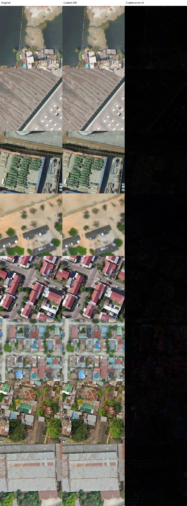
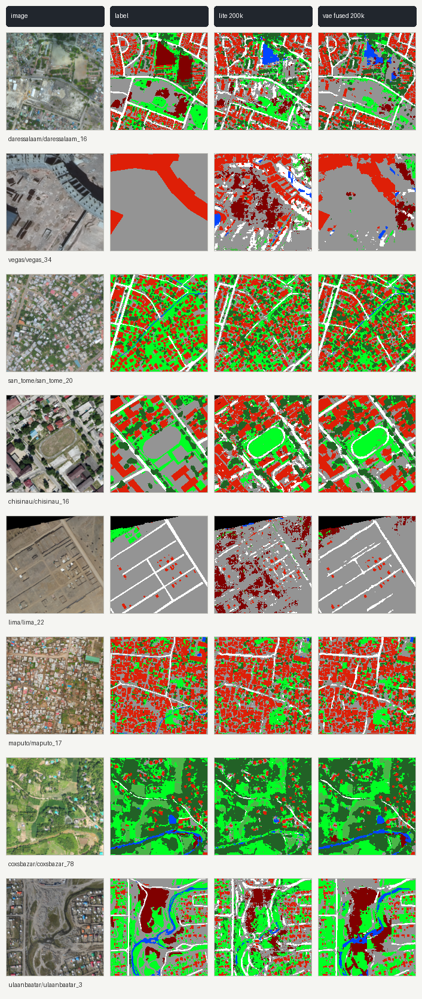

# Sim Satellite

An experiment in generating satellite images with mask-conditioned diffusion.
Draw roads, buildings, trees, and water on a canvas, then generate a fictional
landscape from the mask.

Written in Python with uv. Training and inference run on Modal; a small
FastAPI app serves the drawing canvas. The repo also includes VAE reconstruction
and land-cover segmentation experiments.

## Results

Saved 200,000-step runs: VAE reconstruction (left) and land-cover segmentation
(right). These show reconstruction and labeling, not generation from noise.

<a href="artifacts/openearthmap-custom-vae-f4-c24-h32-train88-val300-200k-grid.png"></a>
<a href="artifacts/segmentation-study-2026-06-28-200k/head-to-head-labelled-lite200k-vs-vae200k-fused200k.png"></a>

Run settings, metrics, research observations, and full-size comparisons are in
[Reproduction.md](Reproduction.md).

## Run

Requires Python 3.12+, uv, and a Modal account for remote runs.

```bash
uv sync
uv run modal setup
uv run sim-satellite --help
```

Follow [reproduction setup](Reproduction.md#run-the-project) to prepare data and
train a checkpoint. Once the web checkpoint is in the Modal artifact volume:

```bash
uv run modal serve -m sim_satellite.modal_app
```

Open the URL printed by Modal. Use `modal deploy` in place of `modal serve`
for a persistent deployment.

Code is [MIT licensed](LICENSE). Dataset-derived figures and checkpoints have
separate non-commercial research terms; see [NOTICE.md](NOTICE.md).
